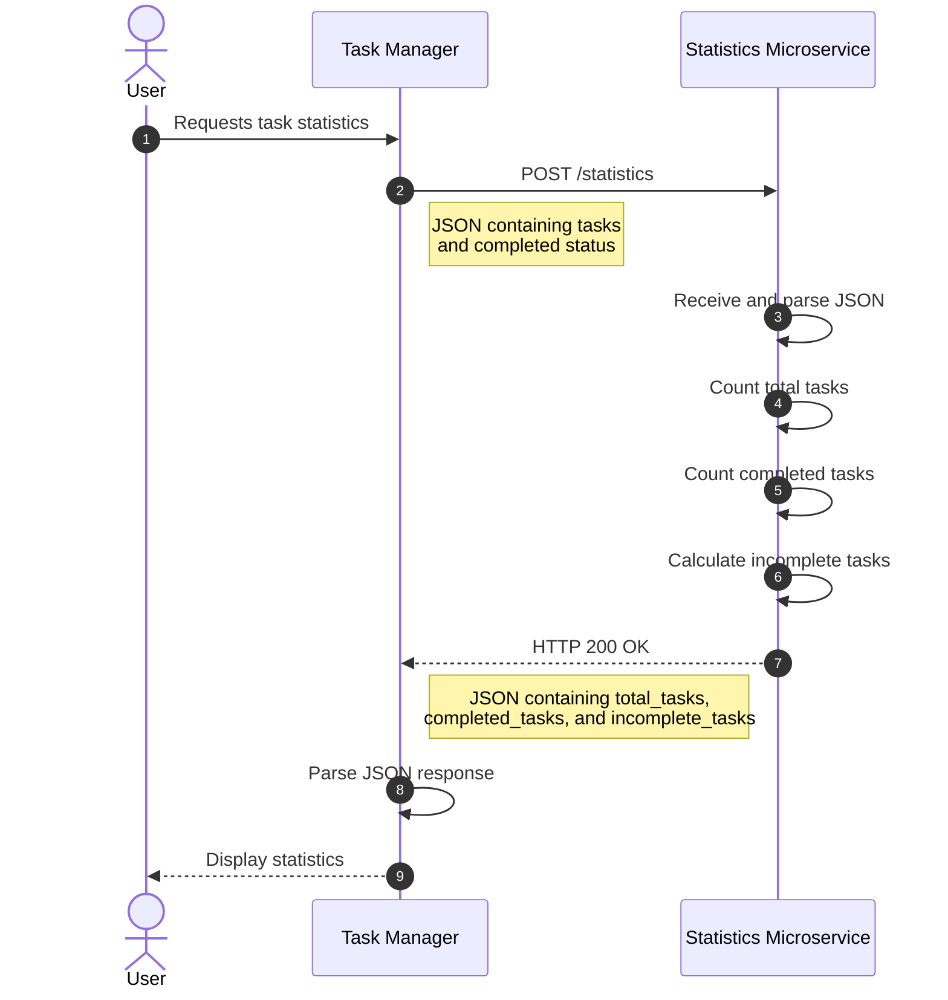

Statistics Microservice:

Description:

This microservice communicates via rest API using HTTP to JSON. The microservice takes various data from an application or in this case a task manager and a password manager, and then presents integer data about the different states of information in the programs. 
The microservice receives information through HTTP POST requests and returns calculated statistics in JSON format.

Requesting data:

The application requests data via an HTTP POST request to one of the endpoints depending on the application. To do so properly you must specify the endpoints in the request such as "statistics". You also specify the array that will be sent example:
 response = requests.post(
            "http://localhost:5001/statistics",
            json={"tasks": tasks}
        )

Receiving data:
The Statistics Microservice returns its results as a JSON object in the HTTP response body. If the HTTP response gives 200 then you can take the data from the returned object. Example:

if response.status_code == 200:
            statistics = response.json()

            print("\nTask Statistics:")
            print(f"Total Tasks: {statistics['total_tasks']}")
            print(f"Completed Tasks: {statistics['completed_tasks']}")
            print(f"Incomplete Tasks: {statistics['incomplete_tasks']}")

        else:
            print("Unable to retrieve statistics.")

UML sequence diagrams:

